<h1 align="center">sideband</h1>

<p align="center">A notch-aware <a href="https://github.com/FelixKratz/SketchyBar">SketchyBar</a> configuration for macOS.</p>

<p align="center">
  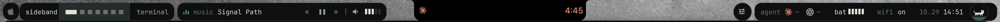
</p>

<p align="center">
  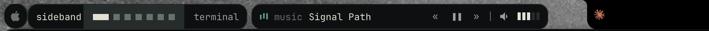
  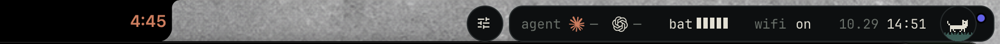
</p>

## popups

Every cell opens one. The track, network, addresses and audio devices below are placeholders.

<table align="center">
  <tr>
    <td align="center" valign="top">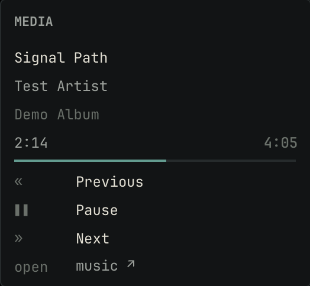<br /><sub><b>media</b> · controls, progress, album</sub></td>
    <td align="center" valign="top">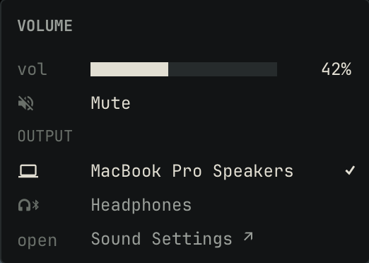<br /><sub><b>volume</b> · slider, audio outputs</sub></td>
    <td align="center" valign="top">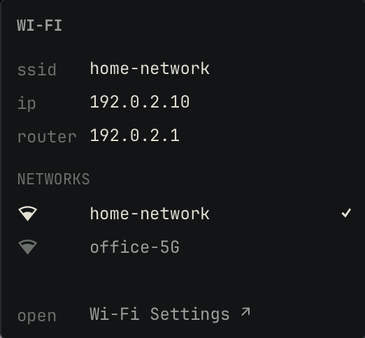<br /><sub><b>wi-fi</b> · network, saved networks</sub></td>
  </tr>
  <tr>
    <td align="center" valign="top">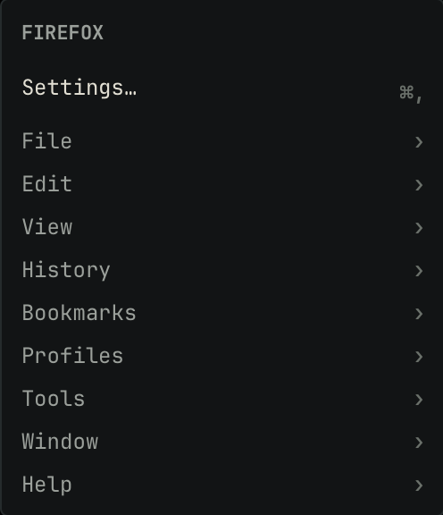<br /><sub><b>app menu</b> · the front app's menus</sub></td>
    <td align="center" valign="top">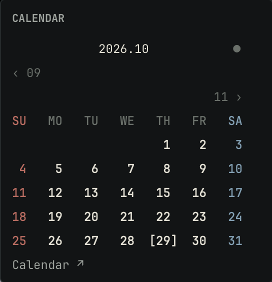<br /><sub><b>calendar</b> · month, events, holidays</sub></td>
    <td align="center" valign="top">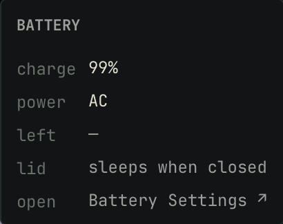<br /><sub><b>battery</b> · power, time left, lid</sub></td>
  </tr>
  <tr>
    <td align="center" valign="top" colspan="2">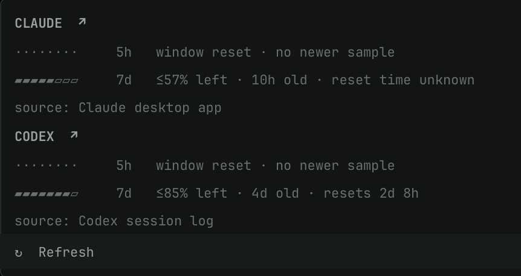<br /><sub><b>agents</b> · quota left, reset, source</sub></td>
    <td align="center" valign="top">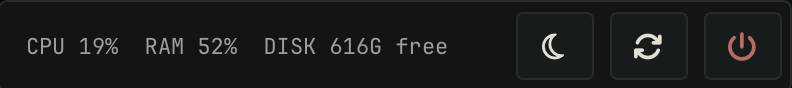<br /><sub><b>cat</b> · CPU, RAM, disk, power</sub></td>
  </tr>
</table>

## features

- **left** — animated wordmark, spaces, active app and app menus
- **media** — playback controls, equalizer, track info, volume and audio outputs
- **right** — agent usage, battery, Wi-Fi, clock and calendar
- **system** — animated pixel cat, CPU / RAM / SSD, power controls
- **extras** — Tailscale, ports, Pilo and window rules

## install

**Requirements:** macOS 14+, [Homebrew](https://brew.sh), Xcode Command Line Tools.

```sh
git clone https://github.com/kiwrwby/sideband_sketchybar.git
cd sideband_sketchybar
bash install.sh
```

`bash install.sh --dry-run` shows what it would do. An existing `~/.config/sketchybar` is moved to `~/.config/sketchybar.bak.<time>`; `--migrate` carries over the settings of an old sketchybar-island setup. On macOS 27.2 the installer uses a patched SketchyBar ([#852](https://github.com/FelixKratz/SketchyBar/issues/852)) and asks before trusting its Homebrew tap.

Allow SketchyBar under **System Settings → Privacy & Security → Accessibility**.

Hide the native menu bar under **System Settings → Menu Bar**, or use [ZapMenu](https://github.com/kaynetik/zapmenu), which the installer can set up.

Update with `git pull && bash install.sh`. Remove with `bash uninstall.sh --restore`, which puts the old config back. Everyday questions are in the [guide](docs/guide.md). If something is off, run `bash scripts/doctor.sh`.

## config

Edit `~/.config/sideband/config.sh` using the settings icon, then reload:

```sh
sketchybar --reload
```

Every option is in that file with its default. The common ones:

```bash
# modules
SHOW_MEDIA=1
SHOW_PORTS=0
SHOW_AGENTS=1
SHOW_CLAUDE_AGENT=1
SHOW_CODEX_AGENT=1
SHOW_GEMINI_AGENT=0
SHOW_OPENCODE_AGENT=0

# appearance
THEME=dark
FONT_FAMILY="JetBrains Mono"
WORDMARK="sideband"

# clock / battery
CLOCK_FORMAT=24
CLOCK_AMPM=off
BATTERY_MODE=bar

# privacy
SHOW_WIFI_NAME=1
```

Directory and git branch (`SHOW_CWD`, `SHOW_GIT`) need one line in your shell:

```zsh
_sideband_cwd() { sketchybar --trigger shell_cwd CWD="$PWD" &! }
precmd_functions+=(_sideband_cwd)
```

```fish
function __sideband_cwd --on-variable PWD
    sketchybar --trigger shell_cwd CWD="$PWD" &>/dev/null &
end
```

## credits

Based on [garamnohhh/sketchybar-island](https://github.com/garamnohhh/sketchybar-island) by garamnoh. MIT license; original attribution retained in [`LICENSE`](LICENSE).

Uses [SketchyBar](https://github.com/FelixKratz/SketchyBar), [media-control](https://github.com/ungive/media-control) and [zapmenu](https://github.com/kaynetik/zapmenu). The macOS 27 fix is [strayer's](https://github.com/strayer/SketchyBar) SketchyBar build.
